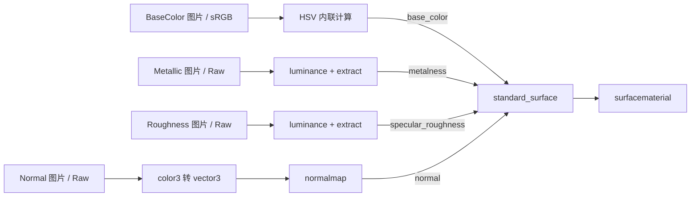
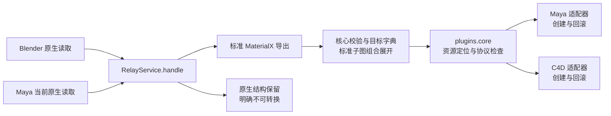

# A12：Blender、Maya 与 C4D 材质交换验证

2026-11-10，使用用户提供的 `A12.blend`，完成 Blender 全量文档导出，以及 50 个不同材质族的 Blender → Maya、Blender → C4D、Maya 原生图再导出 → C4D 验证。本阶段检查节点、有效参数、连线与贴图解释；未渲染、未训练或应用神经校正。

## 实际结果

| 阶段 | 结果 | 证据 |
| --- | --- | --- |
| Blender 全量读取与导出检查 | 1,801 个材质；盘点 486 个引用节点组 | `inventory.json`、`blender-final/summary.json` |
| 标准节点与内联计算子图导出 | 688 份 `.mtlx` | SDK 校验通过；不是所有目标均可转换 |
| 未知／未支持原生图保存 | 1,113 份 `.mtlx` | `preservation_only`，目标转换明确拒绝 |
| 全量文档独立审计 | 1,801 / 1,801 | `documents-audit-final.json`；核对接口、原生连线、常量和原始记录 |
| Blender → Maya 2022 Arnold | 50 / 50，保存重开通过 | `maya-50-final/` |
| Blender → C4D Redshift | 50 / 50，保存重开通过 | `c4d-50-stable/` |
| Maya 当前原生图 → `.mtlx` → C4D | 50 / 50，保存重开通过 | `maya-50-final/export/`、`c4d-from-maya-50-stable/` |

**1,801 份文档不等于 1,801 份已完成语义转换。** 1,113 份原生保留文件用于诊断、追溯和后续规则开发；不能把自定义声明当作可执行的标准材质。

| 成功批次 | 原生功能节点 | 核对的有效未连接输入 | 连接（含表面出口） | 图片节点 |
| --- | --- | --- | --- | --- |
| Maya 50 份 | 994 | 1,475 | 1,565 | 187 |
| C4D 从 Blender 导入 50 份 | 1,764 | 7,933 | 2,481 | 187 |
| C4D 从 Maya 再导出导入 50 份 | 1,764 | 7,933 | 2,481 | 187 |

Maya 节点数不含 shadingEngine，C4D 不含各材质输出节点。Maya 标量广播按逻辑边计数，实际三条分量连接逐一检查。Maya 再导出前另核对 994 个当前原生节点、1,528 个输入（包括几何默认空值）与 1,565 条连接。两端物理节点数量不同，原因是条件等运算需要不同的原生组合。

样本由 `_scripts/select_materialx_batch.py` 在共同支持范围内选出：优先覆盖不同节点功能、0–6 张图片及不同材质族，保留全部 688 个候选的排除原因。它们不是所有复杂材质均可转换的证明。RGBA、UV 矩阵及原生保留文件另作为失败用例，未混入成功数。

实测版本为 Blender 5.2.3 LTS、MaterialX 1.39.5；Maya 2022.5 / Python 3.7.7 / MtoA 5.3.5.3 / Arnold 7.2.5.3；Cinema 4D 2025.3.2 / Redshift 2025.3.0。旧三端原生夹具另完成 6 组源图与 18 组转换回归，见 `native-regression-02/`。Maya 不属于该旧验证器的宿主列表，使用专用验证入口。

最后一次自动检查为 478 项通过；核心、公共宿主流程、资源头读取及 Blender 保留适配层的合计分支覆盖率为 90%，不代表各宿主 SDK／GUI 已达到该覆盖率。Blender 入口重载及 GUI 后台验证通过；Ruff、格式和改动文档的 99 个本地文件链接通过检查。测试日志另有一条既有 pytest 缓存目录写入权限警告，未影响用例结果。

资源完整性报告核对 184 个文件（原始场景、派生材质缓存、182 个不同贴图文件），前后 SHA-256 差异为零；原始场景还与任务开始时的独立哈希一致。另审计 688 份标准文档引用的 1,166 个不同资源文件，其中 1,279 个 PNG／EXR 图片实例的通道描述与文件头一致。后者不是所有资源的任务前后哈希对比。

独立读取原始完整场景的 `source-context.json` 确认工作空间为 Linear Rec.709，与材质缓存导出时使用的亮度上下文一致；没有为目标单独修改色彩设置。

## 最复杂的已打通样本

按共同支持候选的目标功能节点数排序，`material_1500`（`feichuanmoniqi_02`）最高：Maya 69 个节点、126 条逻辑连接，C4D 146 个节点、216 条连接；都包含 4 个图片节点。两条 C4D 来源保存重开后得到相同规模。这里的复杂度反映目标计算图展开，不代表源 Blender 节点最多或覆盖全部未知材质。

Blender 导出的 `material_1500.mtlx` 有 13 个顶层实例，另含 HSV 的完整内联 NodeDef／NodeGraph。Maya 再导出文件位于 `maya-50-final/export/material_1500.mtlx`，从当前 69 个原生节点重新读取。结构主干为：



HSV 在各宿主展开成可编辑数学节点，是节点增加的主要原因。贴图路径、Raw／sRGB、亮度系数、法线转换和最终出口均有结构核对；本阶段仍不判断渲染外观一致性。

## 未识别节点如何处理

正常路径继续使用 `materialx.export`：核心识别和转换，不能完整表达时不输出部分成功图。Blender 读取器会收集同一活动图中多个节点的独立错误，报告节点身份；坐标、组接口等更早阶段的失败仍可能先阻断。全量报告的首错分类不能当作全部问题数量。

额外的 `materialx.preserve` 接受宿主读取的原生快照，保存每个节点的接口、连线和可序列化属性。Blender 接入同时保留递归组定义及图片描述。未知计算只声明自定义 NodeDef；宿主隐式类型变化保留为无实现的显式连接节点，不猜测计算公式。

文件设置 `iris_preservation_only="true"`，返回 `conversion_supported=false`。`materialx.convert` 返回 `MATERIALX_PRESERVED_ONLY`，宿主不得创建替代材质。源结构和错误都保留；没有用中性色或烘焙结果伪装成成功。

原生记录通过带编码标记的 Base64 UTF-8 JSON 属性保存，避免 SDK 写出含 `<`、控制字符等非法 XML 属性。非有限原生值使用 `iris_nonfinite_float` 标签，不能作为有效数值参与转换。原始 `.blend` 仍是完整资产和布局的恢复来源；保留文档不打包像素、动画、外链库或全部 DCC 内部状态。

本次 1,113 个标准导出阻断项中，首错包括未知节点 357、位移 301、原生配置限制 239、坐标来源 74，其余按逐材质报告保留。新增保存能力没有把这些语义缺口改成已支持。

## 发现的问题与处理

| 问题 | 证据与解决方式 |
| --- | --- |
| HSV 展开后其他宿主缺少运算绑定 | 添加 Redshift 除法、最小／最大值、floor、混合、通道与组合节点；条件、clamp 等由目标字典声明的内联子图展开。实际原生图保存重开核对 |
| 同一原生节点有多个字典实现 | Maya 节点与 C4D 材质保存实现提示。核心 `identify` 仍验证当前原生类型和配置；变更未映射属性或伪造类型后拒绝旧提示。提示不是源文档缓存 |
| Maya 未连接法线读回与协议空值不同 | 目录实测 `normalCamera=[1,1,1]`、`coatNormal=[0,0,0]`；资源绑定声明各自隐式几何默认值，公共编码辅助接口处理，其他常量继续保留 |
| Blender 将单通道 EXR 解码为 RGB 缓存 | 按 EXR 文件 `chlist` 识别 Y／RGB／RGBA；源端明确导出灰度组合，Maya 文件通道核对一致。修复样本 `material_0430`，没有跳过该样本 |
| PNG 透明色不一定使用 RGBA 颜色类型 | 检查 IDAT 之前的 tRNS，分别识别调色板及真彩透明度；灰度加 Alpha 双通道仍拒绝。宿主另检查实际解码 |
| 通用运算展开改写了图片辅助节点 | 图片组合由 `ImageGraphReader` 整组核验；目标通用展开保留该边界，避免将灰度图片的辅助 convert 改成另一种结构 |
| Maxon Bool 的 Python 真值代表包装对象有效性 | 使用原生布尔值表示读取数据，重新探测修正 Redshift 目录中 174 个 false 默认值。历史目录及依赖这些默认值的参数核对结论不直接沿用 |
| C4D 在事务中返回旧端口缓存 | 参数写入后，在事务提交及保存重开后核验全部有效常量；不把提交前缓存当作最终写入结果 |
| C4D 图事务和用户数据拆开撤销步骤 | 独立文档准备完整材质，节点事务关闭自动历史；目标文档仅加入最终材质，记录新增对象撤销。实测一次撤销、重做与失败清理 |
| 逻辑色彩名称与 Redshift 原生 ID 不同 | 字典声明 Raw／sRGB 到 `RS_INPUT_COLORSPACE_RAW`／`RS_INPUT_COLORSPACE_SRGB`，公共辅助接口编码／解码；未知名称不自动回退 Auto |
| 每个查询启动一次核心，批处理开销较大 | 增加有界 JSON 行会话，复用一个独立核心进程；超时或坏响应关闭会话，不重放请求。关闭界面或退出批处理时回收进程 |
| 宿主收到错误响应或坏目标图 | 统一检查 API 版本、请求 ID、目标版本及完整 `Material.parse`；宿主异常转成逐材质错误，清理交由各适配器负责 |

比较运算依据 Redshift `Sign(0)=1`：严格大于使用 `(1-sign(b-a))/2`，相等使用 `(sign(a-b)+sign(b-a))/2`。独立数值测试覆盖相等、正负零及接近零的边界；这些测试与结构验证不替代着色器渲染对照。[Maxon 数学节点文档](https://help.maxon.net/r3d/cinema/en-us/Content/html/Math%2BScalar%2BShaders.html)

文件头处理依据 [OpenEXR 布局](https://openexr.com/en/latest/OpenEXRFileLayout.html)及 [PNG tRNS 规范](https://www.w3.org/TR/png-3/#11tRNS)。C4D 事务参考 [Maxon UndoMode](https://developers.maxon.net/docs/cpp/2025_3_0/namespacemaxon_1_1nodes.html)；本轮还发现用户数据影响撤销边界，因此最终采用独立准备文档并实测。

## 抽象接口与核心审计



核心不导入 `bpy`、`maya`、`c4d`。字典保存原生绑定、能力边界和组合规则，官方 NodeDef 的类型与默认值由 SDK 查询。宿主只读写原生数据、解析实际资源、创建／绑定／撤销；没有复制 HSV 或目标比较公式。

公共文件流程位于 `plugins/core.py`，Maya 和 C4D 复用；Blender 保留既有结果类型和界面协议，使用相同核心操作与会话传输。公共协议模型可在 Python 3.7 校验，MaterialX 核心继续在仓库 Python 3.11+ 环境运行。无需 HTTP、宿主 SDK 安装或项目打包。

当前边界仍是受限桥接：不能从接口存在推导任意节点可转换。RGBA 通道能力现在由字典在核心提前阻断，宿主还核对实际文件；复杂坐标、未支持的函数及超范围参数同样必须失败。任意未标记 Maya 原生图仍可能因歧义而拒绝；不存在完整 C4D 原生材质导出器。

## 产物与复现

本机产物根目录名为 `iris-relay-a12-20261110-01`，不提交资产：

- `all-materials-release/`：全部 1,801 份文档及分层状态。
- `blender-final/`：688 份标准／内联子图导出及全量逐项报告。
- `selected-50-final/selection.json`：50 个材质的身份、特征、哈希与全部候选排除原因。
- `maya-50-final/restored.ma`、`maya-50-final/export/`：50 个可编辑 Arnold 材质与真实原生再导出。
- `c4d-50-stable/restored.c4d`、`c4d-from-maya-50-stable/restored.c4d`：两条来源的各 50 个原生 Redshift 材质。
- `maya-transactions/`、`c4d-transactions-03/`：事务与失败注入；Maya 另核验当前参数编辑、未知节点及失效提示。
- `maya-negative/`、`c4d-negative/`：坏文档、缺图、未支持通道、UV 矩阵、原生保留文档的拒绝与场景保护。
- `documents-audit-final.json`、`image-metadata-audit.json`、资源哈希报告：独立审计。

在仓库根目录运行，路径替换为本机位置，每个输出目录必须新建：

```powershell
& "blender.exe路径" --background --factory-startup --disable-autoexec --python-exit-code 1 --python _scripts/verify_blender_batch.py -- --source "A12.blend路径" --out "标准导出目录" --material-cache "新材质缓存.blend路径"
uv run python _scripts/preserve_blender_inventory.py --inventory "只读盘点.json" --exports "标准导出目录" --out "全量文档目录"
uv run python _scripts/select_materialx_batch.py --documents "标准导出目录" --out "50材质目录" --count 50
& "Maya2022/bin/mayapy.exe路径" _scripts/verify_maya_import.py --documents "50材质目录" --out "Maya结果目录" --transactions --export-documents --require-success 50
& "c4dpy.exe路径" -g_licenseModel=LICENSEMODEL::MAXONAPP _scripts/verify_cinema4d_import.py --documents "50材质目录" --out "C4D结果目录" --require-success 50
& "c4dpy.exe路径" -g_licenseModel=LICENSEMODEL::MAXONAPP _scripts/verify_cinema4d_import.py --documents "Maya结果目录/export" --out "Maya到C4D结果目录" --require-success 50
```

Maya 使用已安装的 2022 对应 Arnold 模块及 DLL 搜索路径；仅设置测试进程环境，不修改系统配置。Maya 面板新增“将场景选中的 Arnold 材质导出为 .mtlx”，从当前节点读取，默认警告阻止保存，已有文件不覆盖。

## 已验证边界与剩余工作

本次证明 Iris Relay 适配器在上述精确版本中创建和读回节点，不代表软件菜单自带的 MaterialX 导入器、任意 DCC 或所有 MaterialX 节点均兼容。未验证新版按钮的前台 GUI 点击流程；导出业务和事务通过独立宿主脚本核对。

跨宿主成功样本使用已核验的 1/3 通道图片与默认 UV。RGBA、目标 UV 矩阵、部分程序化／混合节点、位移、体积、UDIM、序列及内嵌像素等继续按报告限制；缺失外链内容不能从节点名推测恢复。组内功能可展开，原组外壳、编辑器排版和被连接覆盖的闲置默认值不属于已还原范围。

场景不自动绑定对象，也不改变灯光、相机、环境、曝光或工作色彩空间。源文件保持只读，贴图仍引用原位置；输出不是可独立搬移的资源包。BSDF、切线、色彩基元、过滤及大数值数学响应没有新增外观一致性证据，神经网络阶段未开始。
